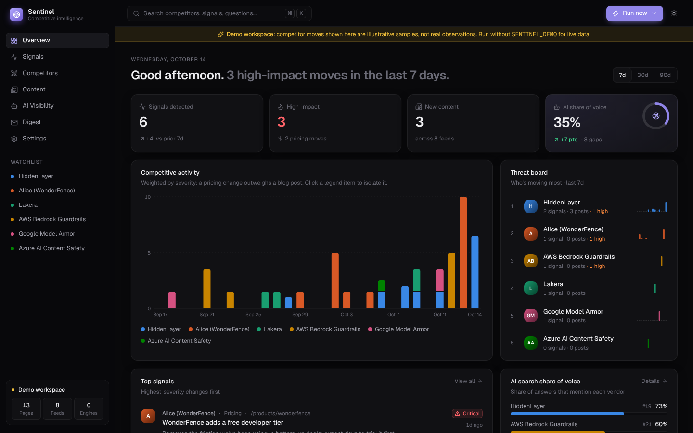
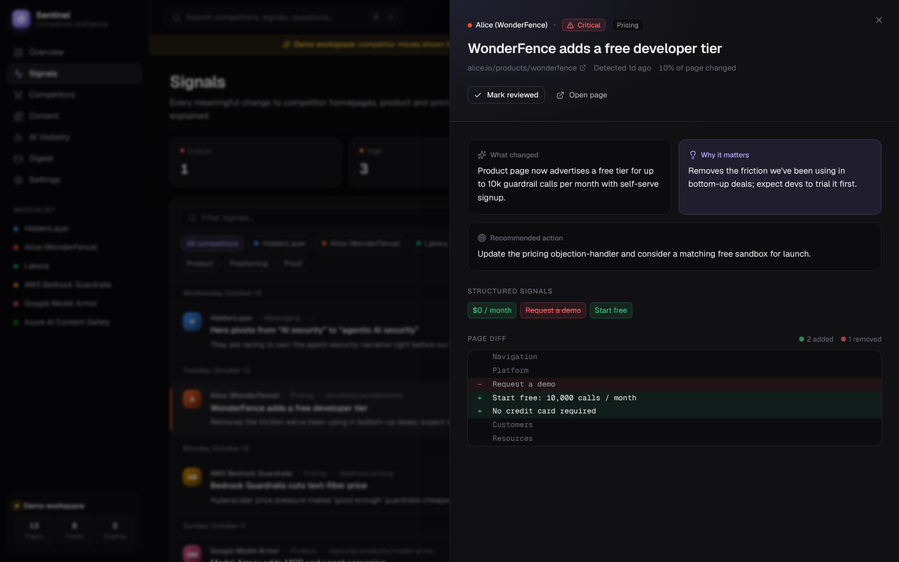
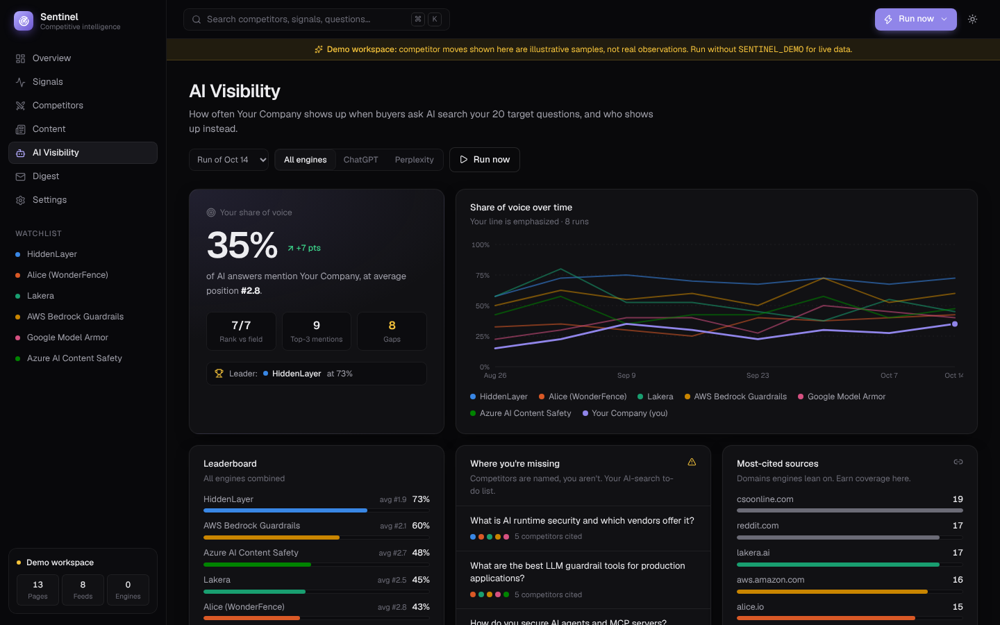

# Sentinel: competitive intelligence monitor

Sentinel watches your competitors, tells you what changed and why it matters, and checks whether AI search recommends you or them.



| | |
|---|---|
| **Page-change detection** | Snapshots competitor homepages, product and pricing pages (JS-rendered with Playwright). It diffs them and pulls out structured signals: hero headline, meta positioning, CTAs, prices, and how often your watch-terms appear ("agentic", "MCP", "free trial"…). Each change is scored for severity, and pricing moves are flagged as critical. |
| **"So what" analysis** | With an Anthropic key, Claude reads every diff and writes a headline, why it matters to *you*, and a concrete battlecard/launch action. Cosmetic changes are filtered out as noise. |
| **Content intake** | Reads RSS/Atom feeds and, for sites without a feed (HiddenLayer, Lakera), scrapes their blog listing pages. Posts are tagged by theme, and a heatmap shows which narratives each competitor is pushing. |
| **AI-search visibility** | Asks Perplexity, ChatGPT (and optionally Claude) your 20 target questions. Records who is mentioned, in what position, and which domains get cited. Tracks share of voice over time and lists the gaps: questions where a competitor appears and you don't. |
| **Live battlecards** | Rebuilt from the latest snapshots on every scan. Copy as Markdown into your battlecard doc. |
| **Weekly digest** | An email/Slack brief covering a TL;DR, what moved, new content, AI share of voice and gaps, with a link back to the dashboard. |

<p>
  
  
</p>

## Quick start

```bash
make install            # Python package + Playwright Chromium + dashboard deps
cp .env.example .env    # add keys (all optional; see below)
make serve              # → http://localhost:8000  (dashboard + API + scheduler)
```

To look around before real data builds up:

```bash
make demo               # illustrative sample data in data/demo.db, shown with a "Demo workspace" banner
```

On its first scan, Sentinel records a **baseline** for every page. Changes show up from the second scan onward. Kick one off from **Run now** in the UI, or run `sentinel pages`.

## Configure

Everything lives in version-controlled YAML in `config/`:

| File | What |
|---|---|
| `watchlist.yaml` | **Your brand** (name + domains, used for AI share of voice). Also competitors, their pages (`homepage`/`product`/`pricing`, with an optional `focus` regex for huge pricing pages), feeds (`rss` or `listing` + `link_pattern`), watch-terms, and ignore patterns. Pre-filled with HiddenLayer, Alice/WonderFence, Lakera, AWS Bedrock Guardrails, Google Model Armor and Azure AI Content Safety. All URLs were verified live. |
| `questions.yaml` | **Your 20 target questions** (placeholders included; replace them) and which engines/models to use. |
| `settings.yaml` | Schedule, fetch behaviour, analysis model, digest options. |

Environment variables (`.env`):

| Variable | Enables |
|---|---|
| `PERPLEXITY_API_KEY`, `OPENAI_API_KEY` | AI-search visibility tracking |
| `ANTHROPIC_API_KEY` | Claude change analysis + AI-written weekly brief (optionally a third search engine) |
| `SLACK_WEBHOOK_URL` | Slack digest (Block Kit) |
| `SMTP_HOST` `SMTP_PORT` `SMTP_USER` `SMTP_PASS` `DIGEST_FROM` `DIGEST_TO` | Email digest |
| `SENTINEL_TOKEN` | Requires a token to open the dashboard/API (set this when hosting publicly) |

With no keys at all, page monitoring, feeds, heuristic severity scoring and the template digest all still work.

## Run it

**Always-on (recommended):** `docker compose up -d`. This runs the dashboard, API and built-in scheduler, with the database on a volume. The default schedule is pages every 6h, feeds every 3h, and AI visibility + digest on Monday mornings.

**Zero infrastructure:** `.github/workflows/monitor.yml` runs the collectors on GitHub Actions and keeps the SQLite DB on a `sentinel-data` branch. Add your keys as repository secrets. To browse the data, download `sentinel.db` from that branch into `data/` and run `sentinel serve`.

**Cron:** `sentinel run && sentinel digest`.

## CLI

```
sentinel pages [--competitor ID]   snapshot pages, detect changes
sentinel feeds [--competitor ID]   pull blog/RSS feeds
sentinel ai [--limit N]            AI-search visibility run (use --limit 2 for a cheap smoke test)
sentinel digest [--no-send]        build (and deliver) the weekly digest
sentinel run                       pages + feeds + ai
sentinel serve [--no-scheduler]    dashboard + API (+ scheduler)
sentinel daemon                    scheduler only
sentinel demo [--clear]            illustrative sample data in a separate demo.db
```

API docs: `http://localhost:8000/api/docs`. Battlecard Markdown: `GET /api/battlecard/{competitor}`.

## Architecture

```
cimonitor/
  collectors/fetch.py      Playwright (JS-rendered) with HTTP fallback, one browser per run
  collectors/pages.py      extract → hash → diff → structured signal delta → severity (+ Claude analysis)
  collectors/feeds.py      RSS/Atom + listing-page scraping, theme tagging
  collectors/ai_search.py  Perplexity / OpenAI Responses (web_search) / Claude (web_search) → mention ranking
  insights.py              read models shared by API + digest (share of voice, gaps, heat, timeline)
  digest.py                one payload → HTML email + Slack Block Kit → SMTP / webhook
  jobs.py                  job runner + tiny cron-like scheduler ("every 6h", "weekly mon 08:00")
  api.py                   FastAPI + static SPA
web/                       React 19 + Vite + Tailwind v4 + Motion + cmdk; hand-built SVG charts
config/                    YAML watchlist, questions, settings
```

Storage is a single SQLite file (`data/sentinel.db`): snapshots, changes, posts, AI results, digests and runs.

## Develop

```bash
make dev     # API on :8000, hot-reloading UI on :5173
make test    # pytest
```
