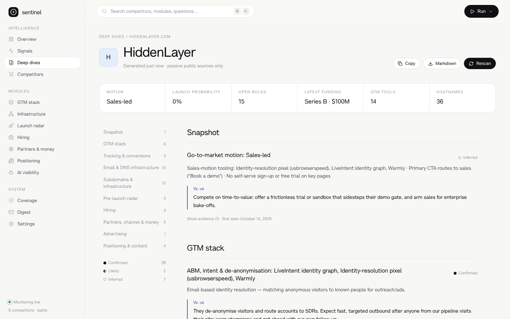
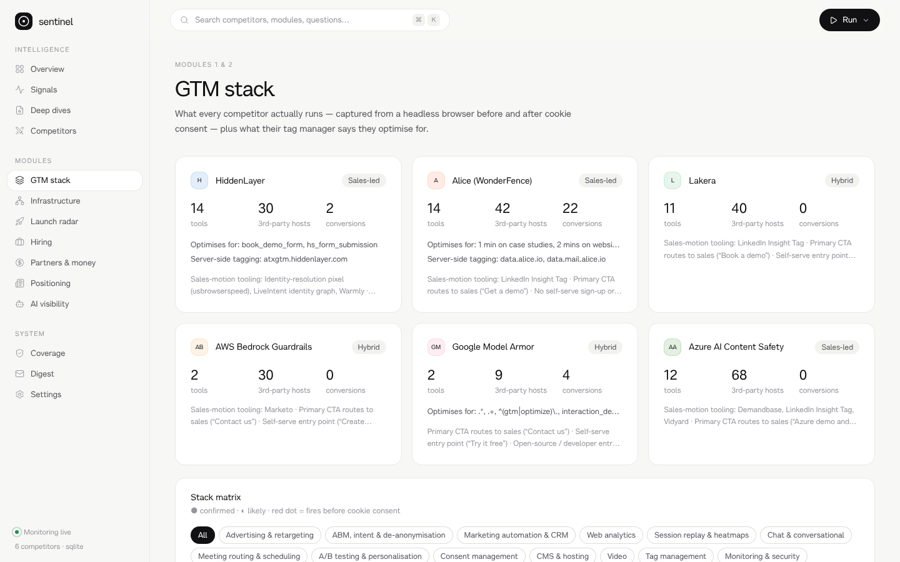
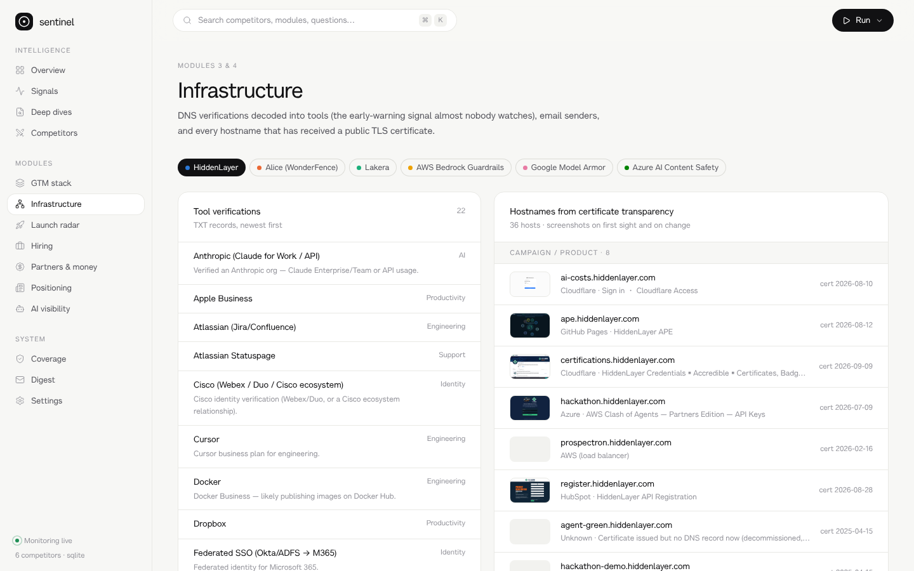

# Sentinel

**GTM-stack intelligence with change detection.** Crayon and Klue track what competitors *say*. Sentinel also tracks what they *do*: their stack, tracking, email and DNS infrastructure, subdomains, staging sites, hiring, partners, ads and AI-search presence. It snapshots all of it on a schedule, diffs it over time, and writes an always-current teardown in which every finding has a recommended response.



<p> </p>

Validated against a manual HiddenLayer teardown: see [docs/VALIDATION-hiddenlayer.md](docs/VALIDATION-hiddenlayer.md).

## What it does

| # | Module | Replaces | Public source | Example finding (live, HiddenLayer) |
|---|---|---|---|---|
| 1 | **GTM stack fingerprinting** | Wappalyzer, BuiltWith, DevTools | Headless Chromium network capture, **before and after cookie consent**; 120+ tool signatures mapped to GTM categories | Warmly, LiveIntent and an identity-resolution pixel fire *before* consent → **sales-led** motion |
| 2 | **Tag manager & conversion forensics** | Manual GTM inspection | The public `gtm.js` container: tags, triggers, IDs, server-side GTM | `book_demo_form` (GA4) fires on `hs_form_submission`; sGTM on `atxgtm.` |
| 3 | **DNS & email infrastructure** | MXToolbox | DNS-over-HTTPS: TXT, SPF, MX, DMARC, DKIM; 60+ verification decoders | Anthropic, OpenAI, Cursor, Pendo and Docker verified; **Mindmatrix** (partner platform) authorised in SPF |
| 4 | **Subdomains & certificates** | Subdomain finders | crt.sh + Cert Spotter CT logs, hosting classification, screenshots | `ai-costs`, `hackathon` ("AWS Clash of Agents"); 22 internal or private names recorded but never contacted |
| 5 | **Pre-launch radar** | Manual staging checks | Sitemaps (prod vs staging), Webflow "Last Published" stamps, GitHub API, **launch probability** | `hiddenlayer-stg.webflow.io` exists. Its robots.txt disallows crawling, so only its existence is recorded |
| 6 | **Hiring intelligence** | LinkedIn Jobs browsing | Greenhouse / Lever / Ashby public APIs; function, seniority, region, tech; **firsts** | 15 roles, 87% go-to-market; federal and UK solutions architects |
| 7 | **Partners, channel & money** | Crunchbase trawling | Partner pages, marketplace links, Google News RSS; funding, investors, ARR claims | Series B $100M (Sep 2026); AWS Marketplace; reseller programme |
| 8 | **Ads intelligence** | Ad library browsing | Google Ads Transparency (official BigQuery dataset), Meta Ad Library API, **cross-checked against pixels** | Google Ads tag live; **no LinkedIn Insight Tag** (answers the LinkedIn ads question) |
| 9 | **Positioning & content** | Crayon / Klue | Page/pricing diffs; H1s, CTAs, personas (buyer hierarchy), industries, use cases; content cadence | Buyer hierarchy and its shifts over time |
| 10 | **AI search visibility** | Manual prompting | ChatGPT, Perplexity, Gemini, Google AI Overviews (+ Claude), run daily | Share of answers, position, cited sources, **source gaps**, **narrative accuracy** |

### The intelligence layer

- **Deep dive in minutes.** Enter a domain and every module runs (a full scan of HiddenLayer took about 6 minutes). Sentinel writes the teardown and keeps it current.
- **"Vs. us" on every material finding.** Claude writes it from your positioning and strengths when `ANTHROPIC_API_KEY` is set; otherwise rule-based responses are used.
- **Evidence trail.** Every claim carries its source URL, timestamp, collection method and, where relevant, a screenshot.
- **Confidence labels.** *Confirmed* means directly observed. *Likely* means strong indirect evidence. *Inferred* means Sentinel derived it from other signals.
- **Method tracker.** A competitor × method coverage matrix, mirroring a hand-built research table.
- **Change alerts.** Every module writes to one fact store, and adds, removals and changes become scored alerts in a single feed and in the weekly email/Slack digest. Each module's first run is a silent baseline, so day one isn't 300 "new" alerts.

### Guardrails (enforced in code; see `cimonitor/guard.py`)

- **Passive and public only.** GET requests only. No logins and no form submissions (partner application forms are *detected*, never submitted).
- **robots.txt respected** for every page fetched; anything disallowed is skipped and logged.
- **Rate limited** per host.
- **Private addresses are never contacted.** Hostnames that name internal systems (vault, argocd, sso, logging…) are recorded from CT/DNS only, *even when they resolve publicly*.
- **No port scanning** (default ports only).
- **Official APIs first**: CT logs, DNS-over-HTTPS, job-board APIs, ad-library APIs. LinkedIn's Ad Library prohibits automated access, so Sentinel provides a deep link instead of scraping it.
- **Audit log.** Every fetch decision (allowed or declined) is shown on the Coverage page.

## Quick start

```bash
make install                 # Python package, Playwright Chromium, dashboard deps
cp .env.example .env         # every key is optional
make serve                   # http://localhost:8000: dashboard + API + scheduler
sentinel scan acme.com       # or "Deep dives → Analyse" in the UI
```

With **no keys at all**, Modules 1–7 and 9 run on free public sources. Keys add AI-search engines (10), Claude analysis ("Vs. us", the "so what" on each change, and the brief), ad libraries (8), and digest delivery.

`make demo` loads illustrative sample data into a separate `demo.db`, shown under a "Demo workspace" banner.

## Configure

| File | What |
|---|---|
| `config/watchlist.yaml` | **Your brand**: name, domains, positioning, ICP, strengths, and `facts` (used to grade AI-answer accuracy). Also competitors, their pages and feeds, and optional `staging`, `github`, `ats`, `partner_pages`, `marketplaces` and `ads`. Most of these are auto-discovered. Domains added from the UI are stored in the database. |
| `config/questions.yaml` | Your **20 target questions** (replace the placeholders) and the engines/models to use. |
| `config/settings.yaml` | Per-module schedule (CT hourly, DNS/stack/radar/hiring daily, AI daily, digest weekly), analysis model, digest. |

## Run it

- **Docker (recommended):** `docker compose up -d` starts Sentinel and Postgres 16, with the built-in scheduler, evidence screenshots on a volume, and the config mounted.
- **Zero infrastructure:** `.github/workflows/monitor.yml` runs every module on GitHub Actions and keeps the database on a `sentinel-data` branch.
- **Cron:** `sentinel run && sentinel digest`.

### Storage and multi-tenancy

- **SQLite by default; Postgres via `DATABASE_URL`.** Every observation keeps its first-seen, last-seen and removed-at timestamps, so the full change history is preserved.
- **Workspaces.** Each tenant has its own config and database (a Postgres schema per workspace) and its own access token:

  ```bash
  sentinel workspace acme "Acme Corp"
  ```

  The dashboard's workspace switcher and the `X-Workspace` API header select between them. `SENTINEL_TOKEN` is the admin token.

## CLI

```
sentinel stack|dns|subdomains|radar|hiring|money|ads|pages|feeds [--competitor ID]
sentinel ai [--limit N]                 AI-search visibility
sentinel deepdive [--competitor ID]     regenerate deep dives
sentinel scan <id-or-domain>            every module for one target, then its deep dive
sentinel run                            everything, then exit (cron/CI)
sentinel digest [--no-send]
sentinel serve [--no-scheduler] | daemon
sentinel workspace <slug> <name>
sentinel -w <workspace> …               run any command in a workspace
```

API docs are at `/api/docs`.

## Architecture

```
cimonitor/
  guard.py                 guardrails: robots.txt, rate limits, private/internal refusal, audit log
  facts.py                 fact store → change events (confidence + evidence on everything)
  signatures.py            120+ tool signatures, tracking-ID patterns
  collectors/
    fetch.py               Playwright behind the guardrails: pre/post-consent capture, screenshots
    stack.py  gtm.py       Modules 1–2 (+ motion classifier, sister-site ID linking)
    dns_infra.py dnsq.py   Module 3 (DNS-over-HTTPS)
    subdomains.py          Module 4
    radar.py               Module 5 (+ launch probability)
    hiring.py              Module 6
    money.py  ads.py       Modules 7–8
    pages.py  feeds.py     Module 9
    ai_search.py           Module 10 (Perplexity, ChatGPT, Gemini, AI Overviews, Claude)
  intel/deepdive.py        auto-generated deep dive with Vs. us
  intel/coverage.py        method tracker
  insights.py digest.py jobs.py api.py tenancy.py db.py (SQLite | Postgres)
web/                       React 19 · Vite · Tailwind v4 · Motion · cmdk, set in Alpha Lyrae
```

## Develop

```bash
make dev                                             # API :8000 + hot-reload UI :5173
pytest -q                                            # 30 tests
TEST_DATABASE_URL=postgresql://… pytest -q           # also exercises the Postgres backend
```

---

Typeface: **Alpha Lyrae** by Fontfabric, under the SIL Open Font License 1.1 (`web/public/fonts/AlphaLyrae-OFL.md`).
